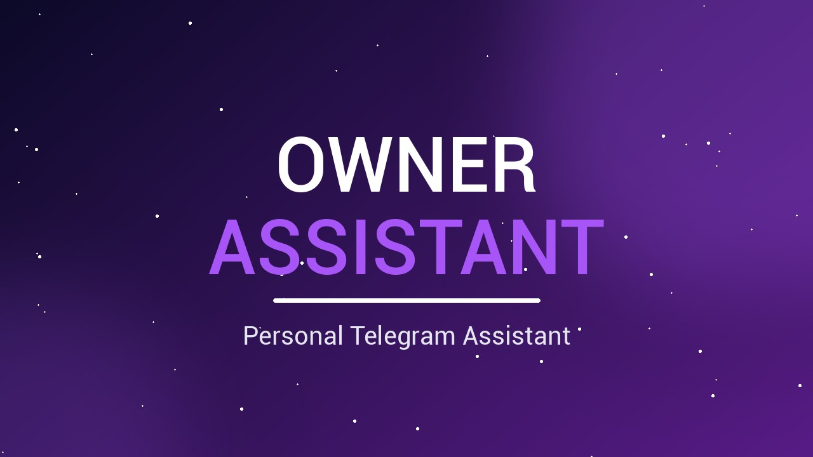

<p align="center">
  
</p>
<h1 align="center">
  <b>OWNER Assistant</b>
</h1>

<p align="center"><b>Personal Telegram assistant (userbot) — 360+ commands, AI, group tools, downloads and more.</b></p>

---

## 🚀 Setup

Sirf **`SESSION`** chahiye, baaki sab bot khud bana leta hai.
Pura step-by-step guide: **[SETUP.md](./SETUP.md)** (Docker / VPS / Termux / Heroku).

**Sabse aasaan (VPS + Docker):**

```bash
git clone https://github.com/Ownermood/Ultroid && cd Ultroid
```

```bash
cp .env.sample .env
```

```bash
docker compose run --rm ultroid python3 resources/session/ssgen.py
```

`.env` mein `SESSION`, `API_ID`, `API_HASH` bharo, phir:

```bash
docker compose up -d --build
```

**Update:**

```bash
git pull && docker compose up -d --build
```

---

## ✨ Kya kya kar sakta hai

| | |
|---|---|
| 🤖 **AI** | `.gemini`, `.gpt`, `.antr` (Claude), `.deepseek`, AI chatbot (`.addai`) |
| 👮 **Groups** | ban, mute, warn, welcome, filters, notes, anti-flood, night mode, gban |
| 🛡️ **Privacy** | PM permit, AFK, auto profile, scheduled messages |
| 📥 **Downloads** | YouTube audio/video, songs, files, Google Drive, web upload |
| 🖼️ **Media** | stickers (kang), convert, compress, remove background, OCR, PDF, TTS |
| 🔎 **Search** | Google, images, Wikipedia, dictionary, weather, translate |
| 🎉 **Fun** | 52 extra addons — jokes, truth/dare, figlet, fonts, games |

Telegram mein **`.help`** likho — saare commands menu mein dikh jayenge.

---

## 🔑 Optional keys

Telegram se set karo (restart nahi chahiye), poori list [SETUP.md](./SETUP.md) mein hai.
Example: `.setdb GEMINI_API_KEY your_key` (free key: aistudio.google.com).

> ⚠️ `SESSION`, `BOT_TOKEN`, API keys kabhi kisi ko mat dena.

---

## 📜 Credits & License

OWNER Assistant is a modified version of [Ultroid](https://github.com/TeamUltroid/Ultroid) by TeamUltroid,
and is distributed under the **GNU Affero General Public License v3** — see [LICENSE](./LICENSE).
`telethonpatch/` is from [Telethon-Patch](https://github.com/New-dev0/Telethon-Patch) (GPLv3, see its LICENSE).
